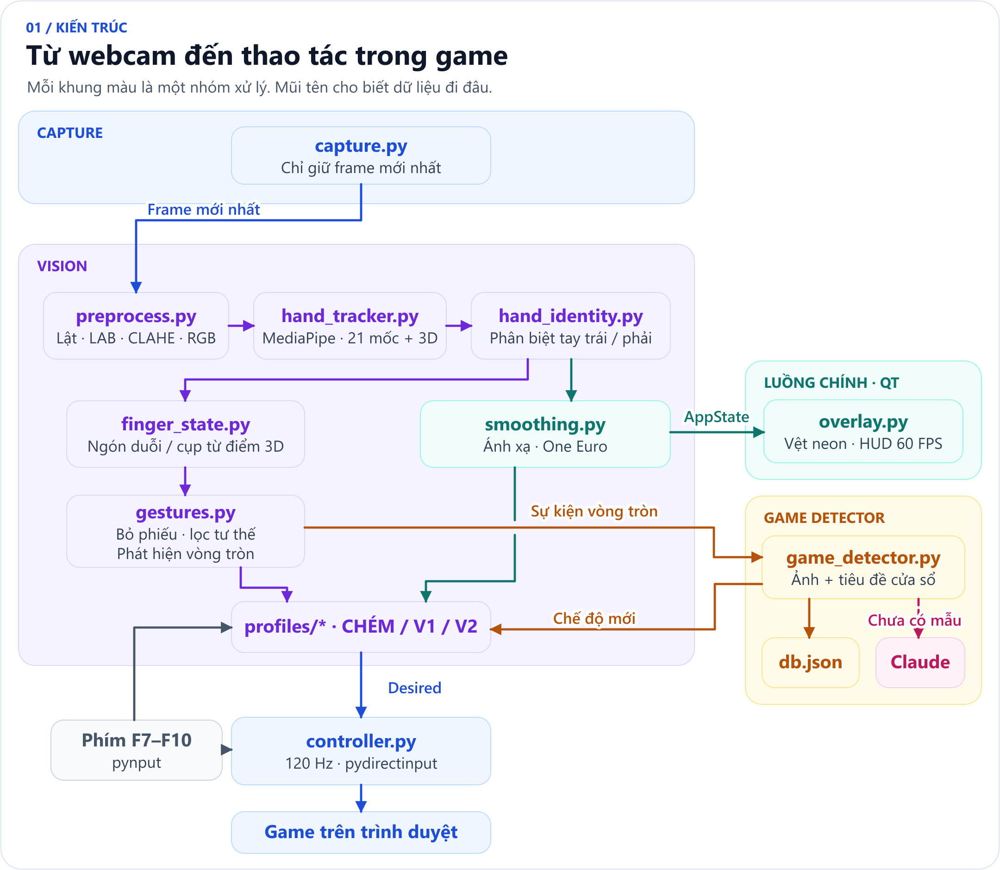

<div align="center">

# HandGameController

**Điều khiển game trên trình duyệt bằng cử chỉ tay qua webcam.**

Đồ án môn Xử lý ảnh số trên Windows. Ứng dụng theo dõi bàn tay theo thời gian thực, hiển thị vệt neon và trạng thái cử chỉ trên màn hình, rồi chuyển động tác tay thành lệnh chuột và bàn phím cho game.


</div>

## Mục lục

- [Tính năng](#tính-năng)
- [Bắt đầu nhanh](#bắt-đầu-nhanh)
- [Cách chơi và phím tắt](#cách-chơi-và-phím-tắt)
- [Kiến trúc](#kiến-trúc)
- [Công nghệ](#công-nghệ)
- [Cấu trúc thư mục](#cấu-trúc-thư-mục)
- [Kiểm thử](#kiểm-thử)
- [Tài liệu](#tài-liệu)

## Tính năng

| Chế độ | Phù hợp với | Điều khiển chính |
| --- | --- | --- |
| **CHÉM** (`slice`) | Game chém hoa quả | Tay phải điều khiển con trỏ. Khép ngón trỏ và ngón giữa để kéo hoặc chém. |
| **BẮN V1** (`shoot_v1`) | Game bắn bia, bắn phản xạ tại chỗ | Tay trái tạo tư thế súng và bóp cò. Tay phải mở ngắm hoặc thao tác menu. |
| **BẮN V2** (`shoot_v2`) | Game bắn súng có di chuyển | Tay trái đi tám hướng và nhảy. Tay phải xoay góc nhìn, ngắm, bắn và nạp đạn. |

- **Phản hồi ngay trên màn hình.** Lớp phủ trong suốt hiển thị vệt neon theo chế độ, tên cử chỉ và khung xem trước webcam có khung xương bàn tay.
- **Nhận diện game bằng vòng tròn.** Vẽ vòng tròn bằng ngón trỏ tay phải để chụp màn hình và tra mẫu đã lưu. Khi chưa có mẫu, ứng dụng gửi ảnh chụp thu nhỏ đến Claude API để phân loại và lưu kết quả cho lần sau.
- **Tập cử chỉ với khung chẩn đoán.** Công cụ xem thử hiển thị điểm mốc, góc khớp và trạng thái ngón tay. Có thể hiệu chỉnh ngưỡng chạm ngón theo tay người dùng bằng **F5**.

## Bắt đầu nhanh

Cần **Windows 10/11**, **Python 3.12** và **webcam**. Kết nối Internet dùng để cài thư viện, tải mô hình MediaPipe nếu máy chưa có và gọi Claude khi gặp game mới.

Mở PowerShell tại thư mục gốc của dự án:

```powershell
py -3.12 -m venv .venv
.\.venv\Scripts\python.exe -m pip install -r requirements.txt
```

Chọn cách chạy phù hợp:

| Lệnh | Mục đích |
| --- | --- |
| `.\.venv\Scripts\python.exe tools\debug_view.py` | Tập cử chỉ và xem các bước xử lý ảnh, không gửi lệnh chuột. |
| `.\.venv\Scripts\python.exe main.py --dry-run` | Xem lớp phủ với chế độ gửi lệnh tắt lúc khởi động. |
| `.\.venv\Scripts\python.exe main.py` | Chạy ứng dụng đầy đủ. Nhấn **F10** để thoát. |

Để bật nhận diện game mới qua Claude, chạy `Copy-Item .env.example .env` nếu chưa có `.env`, rồi điền `ANTHROPIC_API_KEY`. Có thể chơi và đổi chế độ bằng **F8** khi chưa cấu hình khóa API.

## Cách chơi và phím tắt

1. Mở game trên trình duyệt, chạy ứng dụng rồi đưa cửa sổ game lên trước.
2. Ngồi cách webcam khoảng **50–80 cm**, giữ cả cổ tay trong khung hình. Lần đầu có thể nhấn **F5** và làm theo hướng dẫn để hiệu chỉnh ngưỡng chạm ngón.
3. Nhấn **F8** để chọn chế độ hoặc vẽ vòng tròn bằng ngón trỏ tay phải để nhận diện game. Xem cách đặt tay và thực hiện từng động tác trong [bảng cử chỉ](docs/03_cai_dat_va_chay.md#bảng-cử-chỉ).

| Phím | Tác dụng |
| --- | --- |
| **F5** | Hiệu chỉnh ngưỡng chạm ngón. |
| **F6** | Ẩn hoặc hiện khung webcam. |
| **F7** | Đổi chuột tuyệt đối và tương đối trong CHÉM hoặc BẮN V1. BẮN V2 tự chọn theo trạng thái con trỏ Windows. |
| **F8** | Chuyển vòng CHÉM → BẮN V1 → BẮN V2. |
| **F9** | Bật hoặc tắt gửi lệnh. Khi tắt, ứng dụng nhả phím và nút chuột đang giữ. |
| **F10** | Thoát ứng dụng. |

## Kiến trúc



1. **Thu và xử lý ảnh.** Webcam chỉ giữ khung hình mới nhất. OpenCV lật ảnh, đo độ sáng và tăng tương phản khi cần. MediaPipe Gesture Recognizer lấy 21 điểm mốc trên mỗi bàn tay.
2. **Suy ra cử chỉ và lệnh.** Ứng dụng dùng góc khớp 3D để xác định ngón duỗi hoặc cụp, rồi làm mượt tọa độ bằng bộ lọc One Euro. Mỗi chế độ xác định vị trí con trỏ và những phím, nút chuột cần giữ. Controller gửi phần thay đổi đến game.
3. **Hiển thị và nhận diện game.** PySide6 vẽ lớp phủ theo nhịp riêng. Luồng nhận diện game tra mẫu theo tiêu đề cửa sổ hoặc đặc trưng ảnh (dHash và histogram HSV), rồi gọi Claude khi cần.

## Công nghệ

| Thành phần | Công nghệ |
| --- | --- |
| Theo dõi tay và xử lý ảnh | Python 3.12, MediaPipe Gesture Recognizer, OpenCV, NumPy |
| Lớp phủ và xem trước | PySide6 (Qt), OpenCV |
| Điều khiển trên Windows | pynput cho phím tắt, PyDirectInput cho lệnh chuột và bàn phím |
| Nhận diện game | mss để chụp màn hình, JSON để lưu mẫu, Claude API để phân loại game mới |

## Cấu trúc thư mục

```text
HandGameController/
├── main.py            Khởi động ứng dụng, lớp phủ và phím tắt
├── config.yaml        Camera, ngưỡng cử chỉ, ánh xạ phím và độ nhạy
├── requirements.txt   Thư viện Python
├── src/
│   ├── pipeline.py    Điều phối xử lý khung hình và chuyển chế độ
│   ├── profiles/      Quy tắc điều khiển của CHÉM, BẮN V1 và BẮN V2
│   ├── controller.py  Gửi lệnh chuột và bàn phím
│   ├── overlay.py     Hiển thị vệt neon, trạng thái và ảnh webcam
│   ├── game_detector.py  Nhận diện game từ ảnh chụp màn hình
│   └── game_db.py     So khớp và lưu mẫu game
├── tools/             Xem thử cử chỉ, phát lại video và tạo ảnh minh họa
├── models/            Mô hình MediaPipe
├── games/             Nơi lưu mẫu nhận diện game
├── tests/             Kiểm thử logic
└── docs/              Hướng dẫn, sơ đồ và giải thích thuật toán
```

## Kiểm thử

Chạy bộ kiểm thử logic với pytest. Các bài kiểm thử này không cần webcam.

```powershell
.\.venv\Scripts\python.exe -m pytest -q tests
```

Có thể chạy lại pipeline trên video đã quay bằng `tools/replay_video.py`. Xem cú pháp và các tùy chọn trong [hướng dẫn cài đặt và chạy](docs/03_cai_dat_va_chay.md#33-chạy).

## Tài liệu

| Tài liệu | Nội dung |
| --- | --- |
| [01 · Các bước xử lý ảnh](docs/01_cac_buoc_xu_ly_anh.md) | Tiền xử lý, điểm mốc bàn tay, nhận diện cử chỉ và số đo độ trễ. |
| [02 · Kiến trúc và các luồng](docs/02_kien_truc_va_luong.md) | Sơ đồ kiến trúc, trình tự xử lý một khung hình và máy trạng thái các chế độ. |
| [03 · Cài đặt và chạy](docs/03_cai_dat_va_chay.md) | Bảng cử chỉ, game đã thử, tinh chỉnh và xử lý lỗi. |
| [04 · Các cách xoay màn hình](docs/04_cac_cach_xoay_man_hinh.md) | So sánh các cách xoay góc nhìn và cơ chế ba vòng của BẮN V2. |
