# 1. Các bước xử lý ảnh

> **Ảnh minh hoạ** trong tài liệu này được sinh tự động bằng `tools/make_doc_images.py` từ video thử nghiệm thật của người dùng, chạy đúng các hàm của dự án. Chạy lại công cụ đó với video khác để đổi ảnh.

Tài liệu này giải thích từng bước biến ảnh webcam thành lệnh chuột/phím. Ảnh minh họa cho từng bước được chụp bằng `tools/debug_view.py` (nhấn phím `s` để lưu vào `docs/images/`).

```
Webcam ─► (1) Lấy frame mới nhất ─► (2) Lật gương ─► (3) Đo độ sáng (LAB) ─► (4) CLAHE nếu tối
       ─► (5) BGR→RGB ─► (6) MediaPipe: 21 điểm mốc/tay ─► (7) Trạng thái ngón (góc khớp + hysteresis + debounce)
       ─► (8) Cử chỉ ─► (9) Ánh xạ tọa độ + lọc One Euro ─► (10) Profile ─► chuột/phím
Song song: (11) Vòng tròn ─► (12) Chụp màn hình ─► dHash + histogram HSV ─► (Claude API nếu chưa có mẫu)
```

| Bước | Mã nguồn | Kỹ thuật |
|---|---|---|
| 1 | `src/capture.py` | Luồng đọc riêng, `CAP_PROP_BUFFERSIZE=1`, chỉ giữ frame mới nhất |
| 2–5 | `src/preprocess.py` | `cv2.flip`, `cv2.cvtColor` (LAB, RGB), `cv2.createCLAHE` |
| 6 | `src/hand_tracker.py` | MediaPipe Hand Landmarker (CNN phát hiện lòng bàn tay + hồi quy điểm mốc) |
| 7 | `src/finger_state.py` | Hình học vector: góc giữa 2 vector, khoảng cách chuẩn hóa |
| 8 | `src/gestures.py` | Bảng luật trên trạng thái 5 ngón |
| 9 | `src/smoothing.py` | Biến đổi tuyến tính + bộ lọc One Euro |
| 11 | `src/gestures.py` | `cv2.minEnclosingCircle`, góc quét (`np.unwrap`), độ lệch chuẩn bán kính |
| 12 | `src/game_db.py` | `cv2.resize(INTER_AREA)`, dHash, `cv2.calcHist`, `cv2.compareHist` |

---

## Bước 1 – Lấy ảnh từ webcam (giảm trễ)
Mặc định OpenCV và driver giữ một hàng đợi vài frame. Nếu bước xử lý chậm hơn camera thì ảnh được xử lý luôn là ảnh **cũ**, và độ trễ tích lũy dần.

Cách khắc phục trong dự án:
- Mở camera bằng `CAP_DSHOW` với định dạng MJPG và xin 60 FPS.
- Đặt `CAP_PROP_BUFFERSIZE = 1`.
- Một **luồng riêng** đọc camera liên tục và chỉ lưu frame mới nhất (ghi đè). Luồng xử lý luôn lấy frame mới nhất; frame cũ bị bỏ qua chứ không xếp hàng.

> Lưu ý: khi phòng tối, camera tự kéo dài thời gian phơi sáng nên FPS giảm (ví dụ 30 → 20 FPS), làm mỗi frame trễ thêm. Đây là giới hạn phần cứng; cách khắc phục là **bật thêm đèn**. HUD hiển thị FPS thật của camera để kiểm tra.

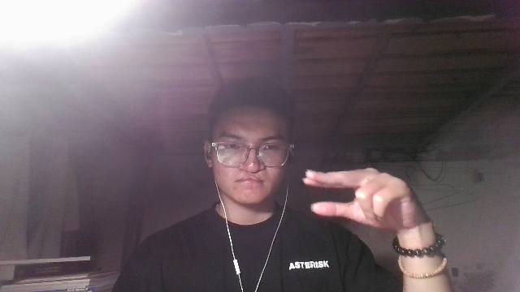
*Ảnh gốc 640×360 lấy từ webcam (một frame trong video thử nghiệm). Đây là đầu vào của toàn bộ chuỗi xử lý.*

## Bước 2 – Lật gương
`cv2.flip(frame, 1)` lật theo trục dọc. Người dùng nhìn màn hình như nhìn vào gương: đưa tay phải sang phải thì con trỏ cũng đi sang phải.

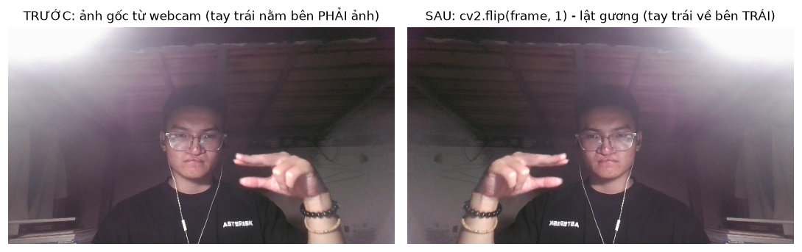
*Trước: tay trái của người dùng nằm bên phải ảnh. Sau `cv2.flip(frame, 1)`: tay trái về bên trái, giống như nhìn gương.*

## Bước 3 – Đo độ sáng trong không gian màu LAB
Ảnh BGR được đổi sang **CIE LAB**. Trong đó kênh **L** là độ sáng cảm nhận, còn **a, b** là thông tin màu. Lấy trung bình kênh L (0–255) làm độ sáng của khung hình. Dùng LAB thay vì làm việc trực tiếp trên B, G, R vì LAB tách được độ sáng ra khỏi màu.

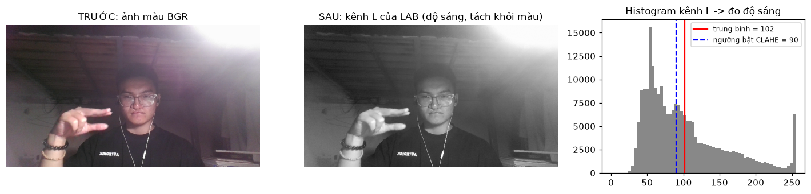
*Trái: ảnh màu. Giữa: kênh L của không gian LAB (chỉ còn độ sáng). Phải: histogram kênh L. Giá trị trung bình (đỏ) cao hơn ngưỡng 90 (xanh) nên ảnh đủ sáng, không cần CLAHE.*

## Bước 4 – CLAHE (chỉ khi tối)
Khi độ sáng thấp hơn `clahe_brightness_threshold` (mặc định 90), dự án áp dụng **CLAHE** (Contrast Limited Adaptive Histogram Equalization) **chỉ trên kênh L**:
- Ảnh được chia thành lưới 8×8 ô, mỗi ô được cân bằng histogram riêng. Nhờ vậy độ tương phản cục bộ tăng lên, đường viền ngón tay rõ hơn.
- `clipLimit = 2.0` cắt bớt các cột histogram quá cao trước khi cân bằng, để không khuếch đại nhiễu ở vùng phẳng.
- Kênh a, b giữ nguyên nên **màu da không bị lệch**. Sau đó ghép 3 kênh lại và đổi về BGR.

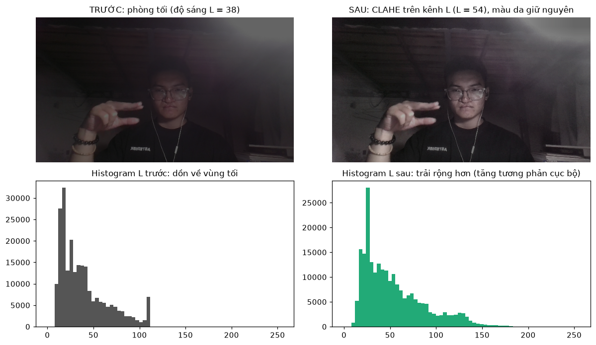
*Giả lập phòng tối (độ sáng L ≈ 38). Sau CLAHE trên kênh L: vùng tối sáng lên, chi tiết bàn tay rõ hơn, còn màu da không đổi vì kênh a, b được giữ nguyên. Histogram từ chỗ dồn về vùng tối được trải ra rộng hơn.*

## Bước 5 – BGR → RGB
OpenCV lưu ảnh theo thứ tự BGR, còn MediaPipe yêu cầu RGB.

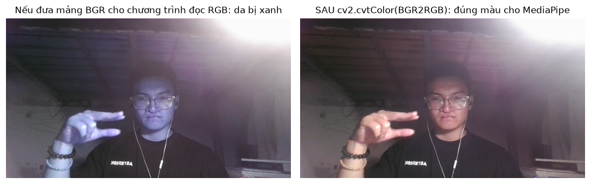
*Nếu đưa mảng BGR của OpenCV cho một chương trình đọc theo RGB (như MediaPipe), kênh đỏ và xanh dương bị tráo nên da chuyển sang màu xanh. Sau `cv2.cvtColor(..., BGR2RGB)` thì màu đúng.*

## Bước 6 – Phát hiện bàn tay: MediaPipe Gesture Recognizer
Dự án dùng mô hình **Gesture Recognizer** chính thức của Google (`models/gesture_recognizer.task`, giấy phép Apache 2.0). Mô hình gồm các mạng CNN nhẹ chạy nối tiếp:
1. **Palm detector**: tìm khung bao lòng bàn tay. Lòng bàn tay cứng và ít biến dạng hơn ngón tay nên dễ phát hiện. Vì vậy **cổ tay và lòng bàn tay phải nằm trong khung hình**.
2. **Landmark model**: trả về 21 điểm mốc theo hai hệ tọa độ:
   - tọa độ **ảnh** (x, y chuẩn hóa 0..1), dùng để vẽ và điều khiển con trỏ;
   - tọa độ **world**: 3D tính bằng **mét**, gốc ở giữa bàn tay. Hệ này không phụ thuộc tay gần hay xa camera và ít méo khi bàn tay xoay, nên dùng để tính góc khớp và khoảng cách giữa các ngón.
3. **Gesture classifier**: phân loại 8 cử chỉ có sẵn (Closed_Fist, Open_Palm, Pointing_Up, Victory, ...) kèm điểm tin cậy. Dự án dùng kết quả này để **kiểm tra chéo** luật hình học ở bước 8.

```
       8   12  16  20          0: cổ tay
       |   |   |   |           1-4: ngón cái (CMC, MCP, IP, TIP)
       7   11  15  19          5-8: trỏ   9-12: giữa
   4   6   10  14  18          13-16: áp út  17-20: út
   3   5---9---13--17          (MCP = gốc ngón, PIP = khớp giữa, TIP = đầu ngón)
    2         |
     1        |
       \_____ 0
```

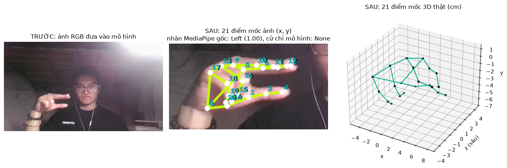
*Trái: ảnh RGB đưa vào mô hình. Giữa: 21 điểm mốc trên ảnh, đánh số 0–20 (0 = cổ tay, 4/8/12/16/20 = đầu ngón). Phải: cùng 21 điểm trong tọa độ 3D thật (cm); trục z là độ sâu, dùng để tính góc khớp.*

### 6b – Xác định tay TRÁI / PHẢI (`src/hand_identity.py`)
**Vì sao hay nhầm:** MediaPipe đoán tay trái/phải từ hình dạng bàn tay và giả định một kiểu lật ảnh nhất định. Chạy thử trên video quay tay trái của người dùng (ảnh đã lật gương như lúc chạy thật), MediaPipe gán tay trái là "Right" ở khoảng **95%** số frame. Vì vậy cấu hình mặc định đảo nhãn (`swap_handedness: true`), và dự án không tin hoàn toàn vào nhãn này:
1. **Thấy 2 tay:** tay có cổ tay nằm bên trái ảnh (ảnh đã lật gương) là tay Trái.
2. **Bám theo vị trí:** ở mỗi frame, bàn tay được ghép với bàn tay ở frame trước có cổ tay gần nhất (dưới 0,15 khung hình) và giữ nhãn cũ.
3. **Tay mới xuất hiện một mình:** cổ tay nằm trong 40% bên trái ảnh thì là tay Trái, trong 40% bên phải thì là tay Phải. Chỉ ở vùng giữa mới dùng nhãn MediaPipe; nhãn này được sửa theo phiếu (mỗi lần thấy 2 tay, so nhãn MediaPipe với luật vị trí) và chốt theo đa số trong 5 frame đầu.
4. **Bỏ bản trùng:** MediaPipe đôi khi phát hiện cùng một bàn tay 2 lần (2 cổ tay cách nhau dưới 0,08 khung hình), nên chỉ giữ bản có điểm tin cậy cao hơn.

Kết quả trên video của người dùng: tay trái được nhận đúng ở **1731/1734 frame**.

## Bước 7 – Ngón DUỖI hay CỤP (trên tọa độ 3D)
**Bốn ngón dài:** tính góc tại khớp PIP trên tọa độ world:
```
θ = arccos( (MCP−PIP)·(TIP−PIP) / (|MCP−PIP|·|TIP−PIP|) )
```
Ngón thẳng có θ ≈ 180°, ngón gập có θ < 120°.

**Ngưỡng lấy từ dữ liệu thật:** trong video, ngón duỗi đo được 141–165°, ngón gập 75–115°, nên đặt ngưỡng DUỖI > 140° và CỤP < 118°.

**Ngón cái:** ngón cái gập ngang vào lòng bàn tay nên dùng khoảng cách thay cho góc:
```
r = |TIP_cái − MCP_giữa| / |MCP_giữa − cổ_tay|
```
Ngón cái chìa ra cho r ≈ 1,0; gập vào lòng cho r ≈ 0,4. Chia cho kích thước lòng bàn tay để r không phụ thuộc kích thước tay.

**Hysteresis + debounce:** chỉ chuyển sang DUỖI khi vượt ngưỡng trên, chỉ chuyển sang CỤP khi dưới ngưỡng dưới, và trạng thái mới phải lặp lại 2 frame liên tiếp (khoảng 66 ms).

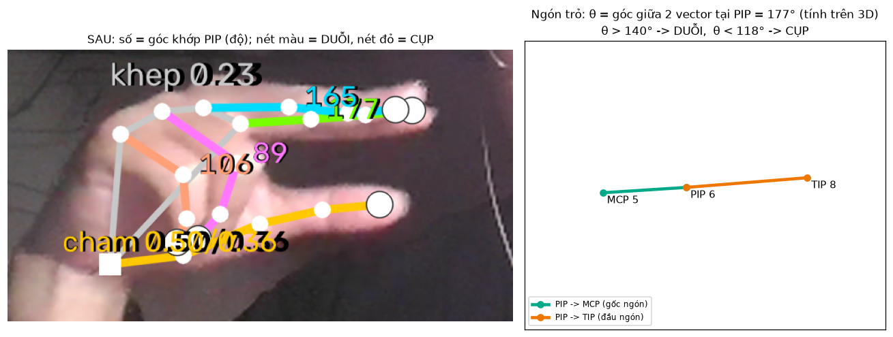
*Trái: số cạnh mỗi khớp giữa là góc PIP; nét màu là ngón DUỖI, nét đỏ là ngón CỤP (ngón áp út 106° và ngón út 89° bị coi là cụp). Phải: cách tính góc ở ngón trỏ, θ là góc giữa 2 vector PIP→MCP và PIP→TIP.*

### 7b – CLICK = ngón cái CHẠM ngón tay khác
Cụp ngón cái là động tác khó nhận (góc thay đổi ít), nên click được đổi thành **đầu ngón cái chạm vào đường ngón trỏ** (click trái) hoặc **ngón giữa** (click phải):
- Đường ngón trỏ = đường gấp khúc qua các khớp 5→6→7→8, **cả ngón từ gốc tới đầu**. Thử thực tế: người dùng hay chạm vào **gốc** ngón trỏ, nên bản đầu (bỏ 30% sát gốc) không nhận được click.
- Khoảng cách từ điểm đến đoạn thẳng AB: chiếu P lên AB, `t = clamp((P−A)·(B−A)/|B−A|², 0, 1)`, khoảng cách là `|P − (A + t(B−A))|`. Lấy giá trị nhỏ nhất trên các đoạn.
- Tính trên **cả ảnh 2D** (chia kích thước lòng bàn tay trên ảnh) **và 3D thật** (chia lòng bàn tay 3D). **Chạm** khi khoảng cách 2D nhỏ (< 0,15) và 3D không quá xa (< 0,45); **nhả** khi 2D > 0,22 hoặc 3D > 0,55. Cần ổn định 2 frame. 3D chỉ là điều kiện lỏng vì độ sâu của webcam một mắt rất nhiễu: thử thực tế, ngón cái chạm rõ trên ảnh (2D = 0,03) nhưng 3D vẫn đo được trên 0,22, làm click không ăn.
- Đo trên video thật: lúc *không* chạm, ngón cái vẫn khá gần (10% số frame có 2D < 0,24), nên ngưỡng phải chặt. Mỗi bàn tay mỗi khác, vì vậy có **hiệu chỉnh F5**: đo 2,5 giây khi tách ngón cái và 2,5 giây khi chạm, lấy trung vị, rồi đặt ngưỡng chạm ở mức 40% và ngưỡng nhả ở mức 60% khoảng cách giữa hai giá trị (lưu `calibration.json`).
- **Sắp chạm** (2D < 0,26) thì khóa con trỏ tại chỗ.

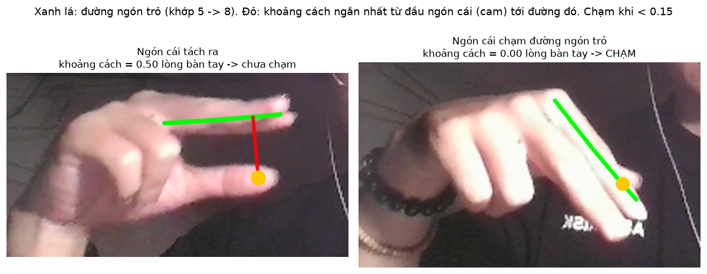
*Đường xanh lá: đường gấp khúc ngón trỏ (khớp 5→8). Đường đỏ: khoảng cách ngắn nhất từ đầu ngón cái (chấm cam) tới đường đó, chia cho kích thước lòng bàn tay. Trái: 0,50 → chưa chạm. Phải: 0,00 → chạm, tức là click trái.*

### 7c – CLICK PHẢI = ngón giữa duỗi NỬA CHỪNG
- Tỉ lệ r = độ dài ngón giữa / độ dài ngón trỏ **trên ảnh** (từ khớp gốc tới đầu ngón). Duỗi thẳng r ≈ 1, gập hẳn r < 0,2, nửa chừng r ≈ 0,25–0,7.
- Vào click phải khi r nằm trong [0,25; 0,70] **liên tiếp 3 frame** và r gần như không đổi (|Δr| < 0,08/frame). Lúc gập hoặc duỗi nhanh, r đi xuyên qua vùng nửa chừng nhưng thay đổi nhanh, nên không bị tính. Thoát khi r < 0,18 (gập hẳn) hoặc r > 0,80 (duỗi thẳng).

### 7d – Click nhanh và giữ để kéo
Lúc bắt đầu click, con trỏ khóa ở vị trí của 100 ms trước. Nếu nhả trước **300 ms** thì con trỏ đứng yên suốt lần click (click đúng chỗ). Nếu giữ lâu hơn, con trỏ mở khóa và đi theo tay để kéo-thả hoặc bôi đen.

## Bước 8 – Tư thế, lọc cử chỉ lạ
**Khép ngón trỏ + giữa** (dùng cho KÉO/CHÉM và SÚNG) kết hợp 2 cách:
1. **Khoảng cách cả ngón:** trung bình |P7 − P11| và |P8 − P12| trên tọa độ 3D, chia lòng bàn tay. Dưới 0,26 thì chắc chắn khép, trên 0,42 thì chắc chắn tách.
2. **Ở vùng giữa, xem ảnh có lộ khe nền không** (`finger_gap_ratio`):
   - lấy màu da mẫu trên chính 2 ngón (ô 5×5 quanh điểm 6, 7, 10, 11) trong không gian **YCrCb** (Cr, Cb mô tả màu da khá ổn định khi độ sáng thay đổi);
   - lấy mẫu pixel trên các đoạn nối ngón trỏ ↔ ngón giữa ở 3 mức (khớp 7–11, giữa đốt, đầu ngón 8–12), chỉ phần 30–70% của đoạn để tránh chính thân ngón;
   - pixel "không giống da" nếu Cr hoặc Cb lệch khỏi màu mẫu quá 2,5 độ lệch chuẩn (+6). Tỉ lệ pixel không giống da dưới 0,25 thì không có khe → **khép**; trên 0,4 thì → **tách**.

**Tư thế tĩnh** được xác định từ trạng thái 4 ngón dài và cờ khép (ngón cái không xét vì ngón cái dùng để click):

| Tư thế | Điều kiện |
|---|---|
| FIST (nắm) | 4 ngón dài đều cụp |
| OPEN (xòe) | cả 4 ngón dài duỗi |
| THREE | trỏ, giữa, áp út duỗi; út cụp (V2: ĐỨNG LẠI) |
| POINTER (con trỏ / di chuyển) | trỏ + giữa duỗi, tách nhau; áp út, út cụp |
| TWO_TOGETHER (súng / kéo) | trỏ + giữa duỗi khép sát; áp út, út cụp |
| INDEX_ONLY (chỉ ngón trỏ) | chỉ ngón trỏ duỗi |
| NONE | các trường hợp còn lại → không nhận |

**Lọc cử chỉ lạ** gồm 4 lớp:
1. **Kiểm tra chéo với mô hình:** nếu Gesture Recognizer chắc chắn (điểm ≥ 0,6) về một nhãn mâu thuẫn, ví dụ tư thế là POINTER nhưng mô hình nói Closed_Fist, thì tư thế bị gán NONE.
2. **Bỏ phiếu theo thời gian:** tư thế chỉ được đổi khi có ít nhất 3 trong 4 frame gần nhất đồng ý (khoảng 130 ms). Một frame sai lẻ không làm đổi cử chỉ.
3. **Loại frame bất thường:**
   - từ 2 khớp gốc ngón (5, 9, 13, 17) trở lên nằm ngoài khung, hoặc cổ tay thấp hơn mép dưới quá 10%. Cổ tay chỉ sát mép dưới vẫn nhận, vì trong video cổ tay thường ở y ≈ 0,98–1,03;
   - **ngón trỏ chĩa vào camera**: độ dài ngón trỏ trên ảnh chia cho độ dài thật (world) nhỏ hơn 0,45, tức ngón bị nhìn từ đầu. Overlay hiện gợi ý "Giơ tay dọc";
   - cổ tay nhảy xa hơn 1 lòng bàn tay chỉ trong 1 frame.

   Frame bị loại không làm đổi trạng thái; chương trình dùng lại bàn tay của frame trước trong tối đa 0,3 giây.
4. **Danh sách cho phép theo chế độ:** mỗi chế độ chỉ chấp nhận một số cử chỉ có tên (xem `03_cai_dat_va_chay.md`). Ngoài danh sách là **KHÔNG RÕ**: không di chuyển chuột và nhả mọi nút.

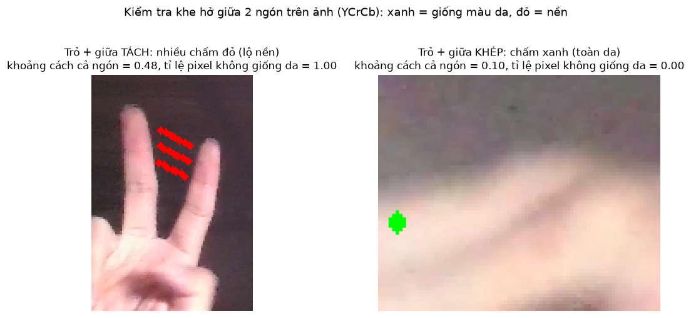
*Kiểm tra khe hở trên ảnh (YCrCb): các điểm lấy mẫu nằm giữa ngón trỏ và ngón giữa. Trái: 2 ngón tách, mọi điểm đều khác màu da (đỏ), tỉ lệ = 1,00 → TÁCH. Phải: 2 ngón khép, các điểm gần như trùng nhau và đều là da (xanh), tỉ lệ = 0,00 → KHÉP.*

## Bước 9 – Ánh xạ tọa độ và làm mượt
**Ánh xạ:** một vùng hoạt động trong khung camera (mặc định x 0,15–0,85, y 0,12–0,80) được kéo giãn tuyến tính ra toàn màn hình:
```
u = (x − x0)/(x1 − x0),   v = (y − y0)/(y1 − y0),   kẹp vào [0, 1]
```
Nhờ vậy tay không cần với ra mép khung hình mới đưa được con trỏ tới mép màn hình. Vùng hoạt động được đặt lệch lên trên để người dùng giữ tay cao, cổ tay luôn nằm trong khung. Tọa độ được giữ ở dạng chuẩn hóa: overlay của Qt (pixel logic) và Windows (pixel vật lý) mỗi bên tự nhân với kích thước của mình, nên không bị lệch khi Windows đặt scale 125–200%.

**Lọc One Euro:** đây là bộ lọc thông thấp có tần số cắt thay đổi theo tốc độ:
```
fc = min_cutoff + β·|ẋ|,   τ = 1/(2π·fc),   α = 1/(1 + τ/Δt),   x̂ = α·x + (1−α)·x̂_trước
```
- Khi tay đứng yên, fc nhỏ nên lọc mạnh và con trỏ không rung.
- Khi tay di chuyển nhanh (chém, vẩy tâm ngắm), fc lớn nên lọc nhẹ và **ít trễ**.

Trung bình động thông thường không làm được điều này: lọc mạnh thì trễ, lọc nhẹ thì rung. Chỉ lọc **một điểm** là đầu ngón trỏ, vì đây là điểm điều khiển con trỏ.

**Gửi chuột 120 lần/giây (`src/controller.py`):** camera chỉ cho 30 vị trí mỗi giây. Nếu nhảy thẳng tới từng vị trí, mắt sẽ thấy con trỏ giật nấc. Một luồng riêng chạy 120 Hz và trượt con trỏ dần tới đích bằng bộ lọc mũ theo thời gian:
```
α = 1 − e^(−Δt/τ),   τ = 25 ms,   con_trỏ ← con_trỏ + α·(đích_dự_đoán − con_trỏ)
đích_dự_đoán = đích + vận_tốc · 16 ms   (giới hạn 40 px; thôi dự đoán nếu frame cũ quá 50 ms)
```
Thêm vùng chết 2 px để con trỏ đứng yên hẳn khi tay đứng yên. Ở chế độ chuột tương đối có **gia tốc**: hệ số nhân tăng theo tốc độ tay, nên di chậm thì chính xác, vẩy nhanh thì con trỏ đi xa. Ngay trước khi nhấn nút, con trỏ được đưa tới đích tức thì để click rơi đúng chỗ.

**Con trỏ "dính" (StickyCursor):** khi đầu ngón chậm hơn 0,08 màn hình/giây trong 80 ms, con trỏ được giữ đứng im. Nó chỉ chạy tiếp khi tay rời điểm giữ quá 0,8% màn hình. Khi ngón cái sắp chạm hoặc vừa click, con trỏ khóa ở vị trí của 100 ms trước, tức lúc tay chưa kịp lệch vì động tác click.

**V2 – chuột tự chọn:** profile gửi cả vị trí tuyệt đối lẫn dịch chuyển tương đối. Controller hỏi Windows tối đa 5 lần/giây: `GetCursorInfo` (con trỏ có đang bị ẩn không) và `GetClipCursor` (con trỏ có bị nhốt trong một vùng nhỏ không). Nếu game đã khóa con trỏ (Pointer Lock của trình duyệt) thì dùng tương đối để xoay màn hình; ngược lại dùng tuyệt đối. Chuyển động tương đối tính từ **đầu ngón thật**, không từ con trỏ đã khóa, để lúc bắt đầu bắn màn hình không giật ngược.

**Đường cong độ nhạy (V2, chuột tương đối):** tay chậm (< 0,25 màn hình/giây) thì nhân 0,3 để ngắm tinh và rung tay không làm màn hình rung; tay nhanh (> 1,5) thì nhân 1,6; ở giữa thì nội suy tuyến tính.

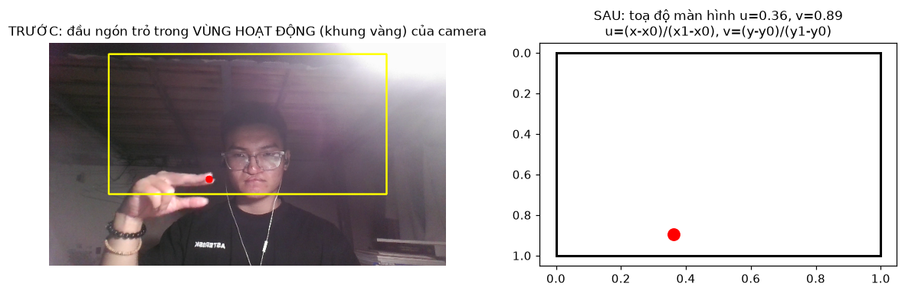
*Ánh xạ: đầu ngón trỏ (chấm đỏ) trong vùng hoạt động (khung vàng) của camera được kéo giãn thành tọa độ màn hình (u, v) trong khoảng 0..1.*

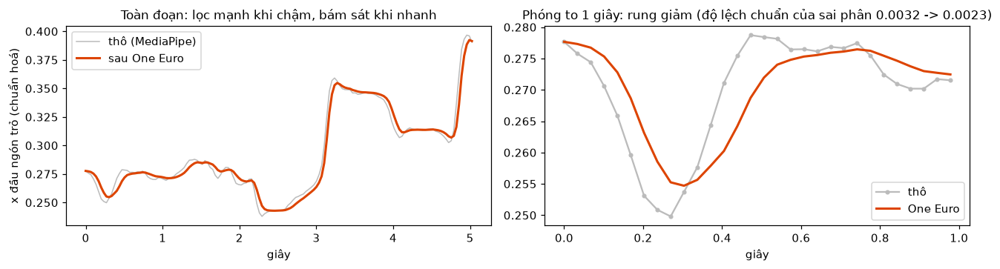
*Bộ lọc One Euro trên 5 giây thật của video. Xám: tọa độ thô từ MediaPipe. Đỏ: sau khi lọc. Khi tay đi chậm thì rung được lọc mạnh; khi tay vẩy nhanh (ví dụ ở giây thứ 3 và 5) thì đường lọc vẫn bám sát.*

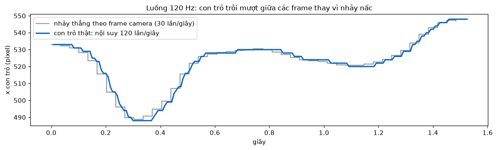
*Luồng 120 Hz. Xám: con trỏ nhảy theo từng frame camera (30 lần/giây) thành bậc thang. Xanh: con trỏ thật được nội suy 120 lần/giây nên trôi mượt hơn giữa các frame.*

## Bước 10 – Chuyển cử chỉ thành lệnh (Profile)
Mỗi frame, profile trả về **trạng thái mong muốn** (nút chuột/phím đang giữ, vị trí con trỏ, tên cử chỉ của từng tay). Controller chỉ gửi phần chênh lệch (xem `02_kien_truc_va_luong.md`). Các động tác click đều là **chuyển trạng thái**: ngón đang duỗi trong một tư thế hợp lệ rồi cụp xuống. Nhờ vậy:
- **Click bằng chạm ngón cái:** ngón trỏ không phải gập nên con trỏ không trượt.
- **Hướng đi V2 (tay trái):** vector từ tâm lòng bàn tay tới trung điểm đầu ngón trỏ và ngón giữa, trên ảnh. Lúc bắt đầu DI CHUYỂN, vector này được lưu làm **hướng gốc** (= đi thẳng). Góc lệch θ so với hướng gốc tính bằng `atan2(gốc × hiện_tại, gốc · hiện_tại)` (dương là quay sang phải). Vector hiện tại được làm mượt bằng trung bình mũ, rồi θ được chia thành 8 hướng 45°; mỗi hướng được nới thêm ±8° (hysteresis) để không nhảy qua lại giữa W và W+A.
- **Ngắm V1:** tâm ngắm nằm đúng chỗ đầu ngón trỏ (cùng điểm với vệt sáng), có "dính" để không rung.

## Bước 11 – Nhận diện cử chỉ vẽ vòng tròn
Quỹ đạo đầu ngón trỏ tay phải trong 1,6 giây gần nhất được kiểm tra 4 điều kiện:
1. **Đủ lớn:** bán kính của `cv2.minEnclosingCircle` ≥ 0,04 (tọa độ chuẩn hóa).
2. **Tròn đều:** độ lệch chuẩn khoảng cách tới trọng tâm / khoảng cách trung bình < 0,35. Đường thẳng hoặc chữ Z sẽ có tỉ lệ này rất lớn.
3. **Đủ một vòng:** tính góc `atan2` của từng điểm quanh trọng tâm rồi dùng `np.unwrap` để bỏ bước nhảy ±2π. Tổng góc quét phải ≥ 300°.
4. **Khép kín:** điểm đầu gần điểm cuối.

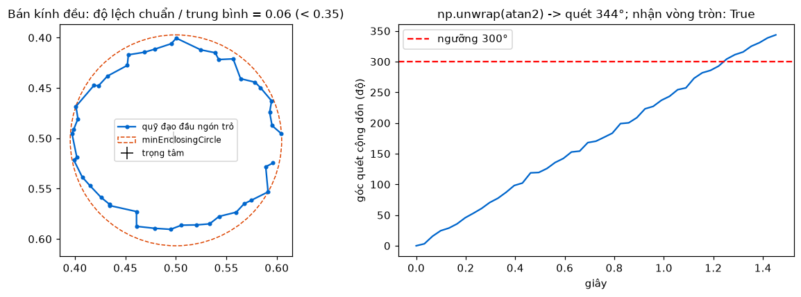
*Trái: quỹ đạo đầu ngón trỏ vẽ một vòng (có nhiễu), kèm vòng tròn bao nhỏ nhất (`cv2.minEnclosingCircle`) và trọng tâm; độ lệch bán kính = 0,06 < 0,35 nên đủ tròn. Phải: góc quét cộng dồn sau `np.unwrap` đạt 344°, vượt ngưỡng 300° nên chương trình nhận là một vòng tròn.*

## Bước 12 – Nhận diện game bằng đặc trưng ảnh
Ảnh chụp màn hình được mô tả bằng hai đặc trưng:

**dHash (difference hash) 64 bit:**
1. Đổi sang ảnh xám rồi thu nhỏ về 9×8 bằng `INTER_AREA` (lấy trung bình vùng). Bước này bỏ hết chi tiết nhỏ, chỉ giữ bố cục sáng/tối.
2. So mỗi pixel với pixel bên phải: sáng hơn thì bit là 1, ngược lại là 0, tổng cộng 8×8 = 64 bit.
3. Hai ảnh giống nhau thì **khoảng cách Hamming** (số bit khác nhau) nhỏ. Ngưỡng mặc định là ≤ 10.

**Histogram màu HSV 2 chiều:**
1. Thu nhỏ ảnh và làm mờ Gauss 5×5 để khử nhiễu, sau đó đổi sang HSV.
2. Lấy histogram H (30 bin) × S (32 bin), chuẩn hóa tổng bằng 1. Đặc trưng này mô tả "bảng màu" của game và không phụ thuộc vị trí các vật thể.
3. So hai histogram bằng hệ số tương quan (`HISTCMP_CORREL`), ngưỡng ≥ 0,70.

Hai ảnh được coi là cùng game khi **tiêu đề cửa sổ trùng**, hoặc **cả hai** đặc trưng ảnh đều đạt ngưỡng. Nếu không khớp mẫu nào, ứng dụng mới gọi Claude API, rồi lưu đặc trưng mới vào `games/db.json` để lần sau không cần gọi.

---

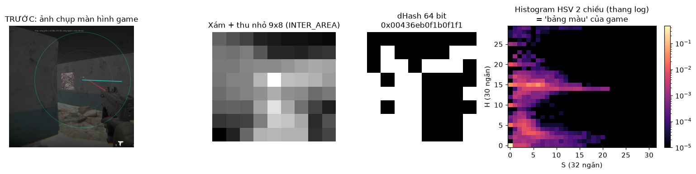
*Từ trái sang: ảnh chụp màn hình game, ảnh xám thu nhỏ 9×8, 64 bit dHash (trắng = pixel sáng hơn pixel bên phải), và histogram HSV 2 chiều (thang log), tức "bảng màu" của game. Hai ảnh chụp cùng một game có dHash gần nhau và histogram tương quan cao.*

## Độ trễ (số đo thực tế để đưa vào báo cáo)
Đo trên máy phát triển (webcam tích hợp 640×480, phòng hơi tối):

| Khâu | Thời gian |
|---|---|
| Tiền xử lý + MediaPipe | ~15–21 ms/frame |
| Từ lúc nhận frame đến lúc gửi lệnh (trung bình, đo trên HUD) | ~15–21 ms |
| Khoảng cách giữa 2 frame camera (đo được 20–30 FPS tùy ánh sáng) | 33–50 ms |
| Debounce cử chỉ (2 frame) | 66–100 ms |

Ước tính tổng độ trễ hệ thống khoảng 0,1–0,17 s. Game phản xạ 0,4 s (Rattlesnake Reflex) vẫn chơi được nếu phòng đủ sáng. Có thể giảm thêm bằng cách đặt `debounce_frames: 1`, đổi lại cử chỉ sẽ dễ nhấp nháy hơn.

## BÓP CÒ ở V1: gập khớp thứ 2 của ngón cái (thử nghiệm và số đo)
Ba cách đã được thử và đo trên video thật quay tay trái của người dùng (1763 frame; trong video người dùng **không** bắn, nên mọi lần "bắn" đều là bắn nhầm):

| Cách nhận BÓP CÒ | Bắn nhầm |
|---|---|
| Ngón cái khép/chạm ngón trỏ, hoặc tỉ lệ ngón cái nhỏ | 22% số frame giơ súng |
| Khớp ngón cái "cử động nhẹ" (đo trong hệ trục gắn với bàn tay, ngưỡng 0,25) | khoảng 4,7% số frame |
| **Gập khớp IP:** góc (điểm 2 → 3 → 4) giảm ≥ 35° so với lúc thẳng nhất trong 0,5 giây gần nhất **và** < 130° | **0/540 frame giơ súng** |

Cách thứ ba được chọn. Góc khớp tính trên tọa độ 3D nên không đổi khi bàn tay nghiêng, xoay hay dời để ngắm. Hành động "gập" được nhận theo **độ giảm** so với lúc ngón cái thẳng, nên không phụ thuộc thói quen để ngón cái hơi cong của từng người. Có hysteresis: duỗi ra quá 140° thì mới ngừng bắn.

**Cập nhật theo yêu cầu người dùng:** ngoài cách gập khớp IP, việc **gập ngón cái vào lòng bàn tay** hoặc **chạm ngón trỏ** cũng là bắn. Điều kiện "sắp chạm" (ngưỡng lỏng) được bỏ khỏi cách này; khi đo lại trên cùng video, tỉ lệ bắn nhầm giảm từ 22% xuống 7,2%. Khi chơi thật, tay giữ tư thế súng ổn định nên tỉ lệ còn thấp hơn. Muốn tắt cách này thì đặt `v1_fire_on_close: false`.
