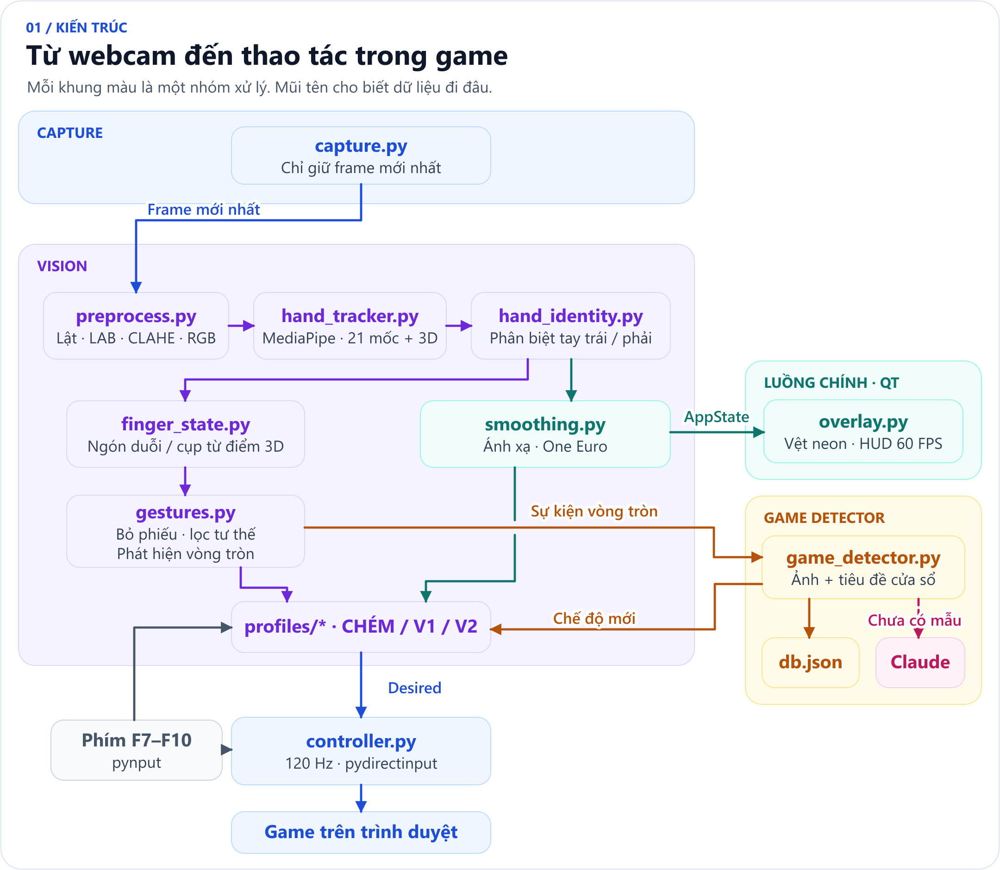
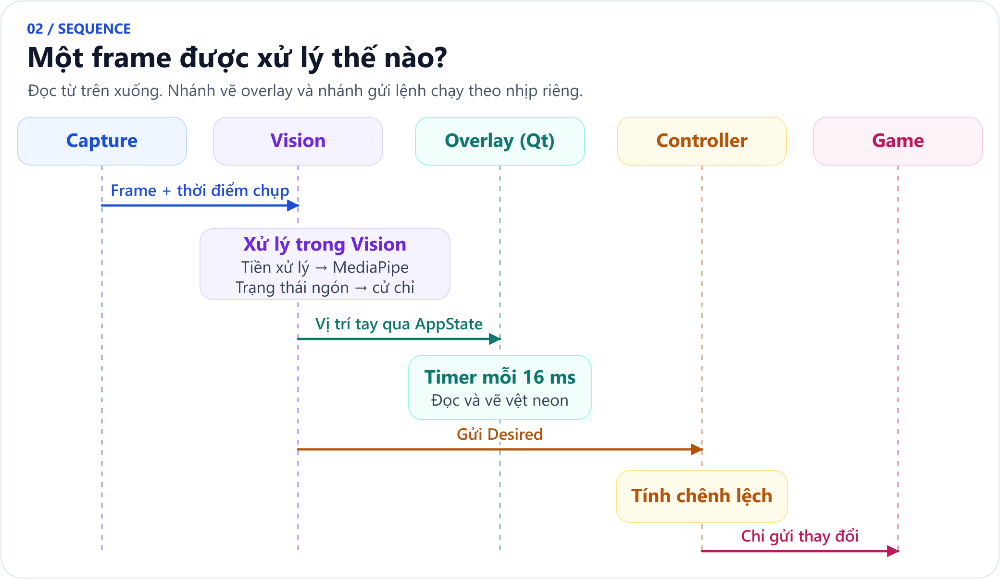
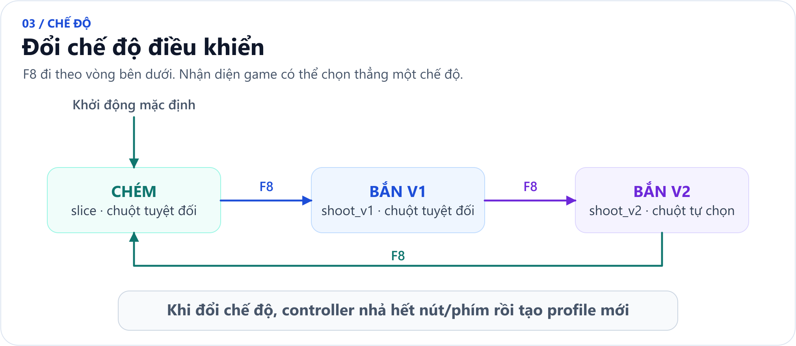
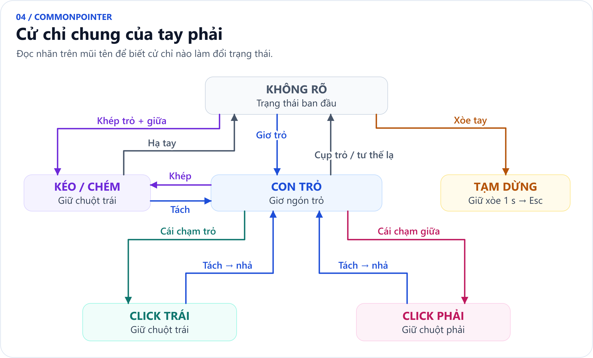
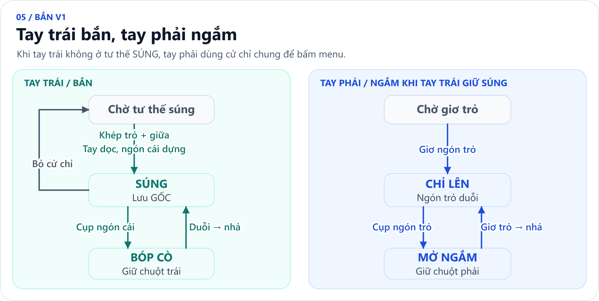
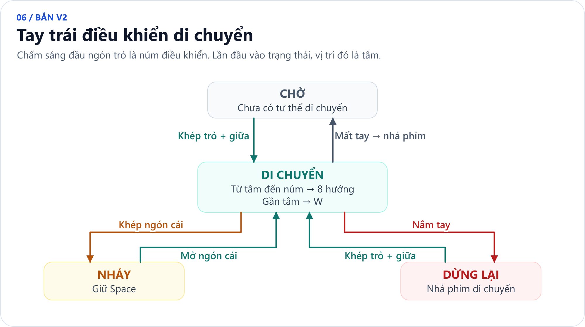
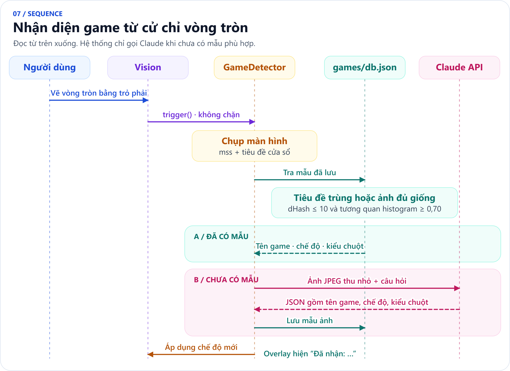

# 2. Kiến trúc và các luồng

## 2.1 Tổng quan các module



| Luồng | Nhiệm vụ | Vì sao tách riêng |
|---|---|---|
| Capture | Đọc webcam liên tục | Không để hàng đợi frame cũ làm tăng trễ |
| Vision | Xử lý ảnh, cử chỉ, gửi lệnh | Khâu nặng nhất (~21 ms), chạy theo nhịp camera |
| Main (Qt) | Vẽ neon và HUD | Vẽ đều 60 FPS, độc lập với tốc độ camera; đọc thẳng vị trí tay nên không chờ controller |
| Game detector | Chụp màn hình, so mẫu, gọi API | Gọi API mất 1–5 s; nếu chạy chung luồng thì game bị "đơ" trong lúc đó |
| pynput listener | Phím tắt toàn cục | Vẫn nhận được F10 ngay cả khi cửa sổ game đang được focus |

Dữ liệu dùng chung (`AppState`) được bảo vệ bằng `threading.Lock`. Camera báo có frame mới bằng `threading.Condition`, còn game detector được đánh thức bằng `threading.Event`.

## 2.2 Luồng xử lý một frame



## 2.3 Trạng thái mong muốn và "cụp là giữ, duỗi là nhả"
Profile **không** gửi lệnh trực tiếp. Mỗi frame nó trả về `Desired = {nút đang giữ, phím đang giữ, con trỏ}`. Controller tính phần chênh lệch:
```
nhả  = đang_giữ − mong_muốn
nhấn = mong_muốn − đang_giữ
```
Thiết kế này có ba lợi ích:
- Ngón còn cụp thì nút còn nằm trong `Desired`, nên nút được giữ (bắn liên thanh, giữ ngắm).
- Mất tay, bấm F9 hoặc thoát thì `Desired` rỗng, mọi nút được nhả, **không bao giờ kẹt phím**.
- Nếu tay mất dấu ngắn (dưới 0,3 s), vision dùng lại trạng thái tay cũ, nên nút không bị nhả rồi nhấn lại ngoài ý muốn.

## 2.4 Máy trạng thái các chế độ

Mỗi lần đổi chế độ, controller nhả hết nút và phím rồi tạo profile mới. V2 tự chọn kiểu chuột theo trạng thái con trỏ Windows. CHÉM và V1 mặc định dùng chuột tuyệt đối.

### Cử chỉ chung (tay phải) – CHÉM và menu (`CommonPointer`)

Máy trạng thái chạy **một lượt mỗi frame, không gọi đệ quy**. Một trạng thái chỉ được vào khi tư thế (đã bỏ phiếu) **và** trạng thái ngón hiện tại cùng đồng ý. Phiên bản trước bị RecursionError: khi hạ tay khỏi KÉO/CHÉM, tư thế bỏ phiếu vẫn là TWO_TOGETHER nhưng các ngón đã cụp, nên hai nhánh đẩy qua đẩy lại không dừng. Ở V1, KÉO/CHÉM bị tắt (`allow_drag=False`).

### CHÉM
Chỉ đọc tay phải và dùng toàn bộ cử chỉ chung. Chém = KÉO / CHÉM (khép ngón trỏ và ngón giữa).

### BẮN V1

Khi tay trái không SÚNG, tay phải dùng cử chỉ chung để bấm menu. Nếu mất tay trái quá 0,5 giây thì xóa GỐC.

### BẮN V2
- **Chuột tự chọn:** profile gửi cả vị trí tuyệt đối lẫn dịch chuyển tương đối. Controller dùng tuyệt đối khi con trỏ Windows đang hiện (menu), và dùng tương đối khi game khóa/ẩn con trỏ (trong trận).
- **Tay phải** (không vẽ vệt sáng): 1 ngón trỏ = XOAY theo **kiểu cần gạt** (lệch khỏi tâm xoay thì xoay liên tục, xem `04_cac_cach_xoay_man_hinh.md`); khép trỏ + giữa = NGẮM (giữ chuột phải, vẫn xoay được); khép ngón cái = BẮN (chuột trái); xòe bàn tay = NẠP ĐẠN. Bắn nhanh thì không xoay để phát bắn không lệch.
- **Tay trái:**


## 2.5 Nhận diện game: cache trước, AI sau


- Lời gọi API dùng model `claude-opus-5-5` với effort `low` vì đây là bài phân loại đơn giản. Kết quả bị ràng buộc theo JSON schema (`output_config.format`) nên luôn đọc được bằng `json.loads`.
- Nếu thiếu key hoặc lỗi mạng, ứng dụng báo lỗi trên overlay và giữ nguyên chế độ cũ. Người dùng vẫn đổi chế độ được bằng F8.
- Nếu game khóa con trỏ, bấm F7 để đổi kiểu chuột; lựa chọn này được lưu vào mẫu của game.

## 2.6 Khung camera xem trước
Sau khi đã gửi lệnh cho frame hiện tại, luồng vision mới thu nhỏ ảnh (360 px, `INTER_AREA`) và vẽ khung xương bàn tay bằng OpenCV (`src/visualize.py`). Ảnh này được ghi vào `AppState.preview`, và overlay vẽ nó ở góc màn hình. Vì bước vẽ diễn ra **sau** khi gửi lệnh, nó không làm tăng độ trễ điều khiển. `tools/debug_view.py` dùng chung hàm vẽ này.

## 2.7 Lớp phủ trong suốt
- Cờ Qt: `FramelessWindowHint | WindowStaysOnTopHint | Tool | WindowTransparentForInput`, cùng `WA_TranslucentBackground`.
- Windows: cửa sổ có `WS_EX_TRANSPARENT`, nên mọi click (thật và giả lập) đi xuyên xuống game. Thêm `WS_EX_NOACTIVATE` để overlay không lấy focus của game.
- Mỗi tay chỉ có **1 vệt neon ở đầu ngón trỏ**, kèm **tên cử chỉ** cạnh vệt. Mỗi lần cử chỉ đổi, một thông báo nhỏ hiện ở giữa phía trên ("Tay phải: CLICK TRÁI"). Vị trí vệt được nội suy mỗi 16 ms nên trôi mượt dù camera chỉ 30 FPS.
- Hiệu ứng neon: mỗi đoạn của vệt được vẽ 3 lần (quầng rộng 22 px với alpha 18%, thân 10 px với alpha 55%, lõi trắng 3 px). Alpha và độ dày giảm tuyến tính theo tuổi của đoạn (0,35 s).
